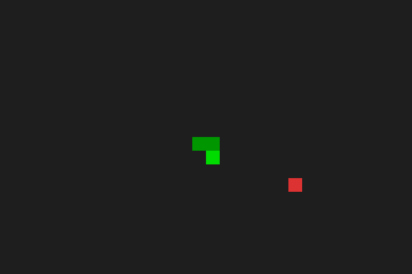
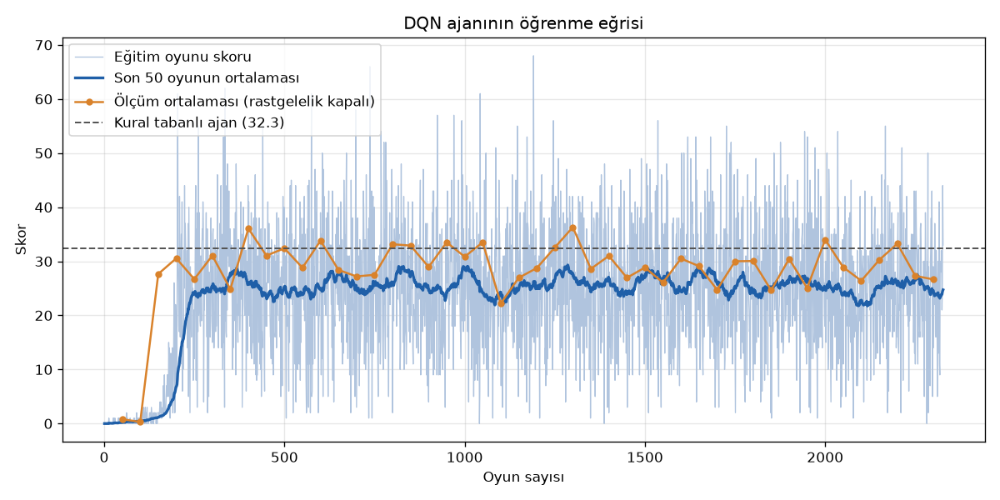
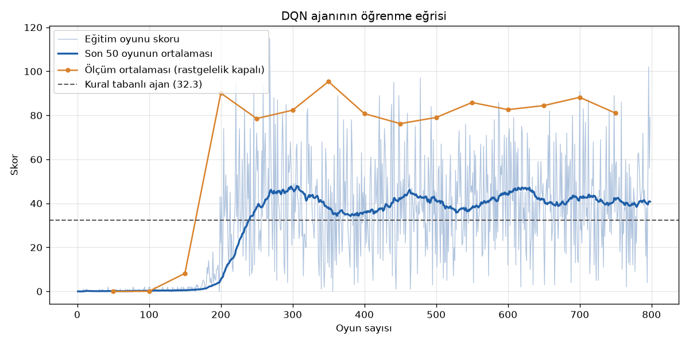

# AI Snake: Deep Q-Learning vs. Hand-Written Rules

A classic Snake game written with Pygame, plus an agent that learns to play it by itself using
Deep Q-Learning (DQN). The trained agent is compared against hand-written rule-based agents
under a fixed evaluation protocol: 500 games, a fixed seed, and the standard error reported.



*DQN v2 playing one full game (seed 0, the first game of the evaluation set; it scores 90, close to its
average of 92.6). The GIF runs at 2× the speed of `play_ai.py`. The in-game text is in Turkish
("Oyun Bitti" = "Game Over").*

## Key result

**The learned agent plays as well as a simple rule that sees the same information. It does not beat it.**
Most of the improvement came from **what the agent was allowed to see**, not from the learning algorithm.
Once both agents were given a flood-fill "reachable area" feature, both went from about 32 to over 90 points.

## Results

All agents were measured the same way:
- `python -m ai.evaluate`
- 500 games, seed 0
- greedy play (no random moves)

| Agent | Input (state) | Mean score | Std. error | Median | Max |
|---|---|---|---|---|---|
| Rule-based | 11 values | 31.71 | 0.55 | 30.0 | 84 |
| Rule-based + flood fill | 14 values | **95.67** | 1.04 | 96.0 | 167 |
| DQN v2 | 14 values | 92.63 | 1.12 | 94.0 | 153 |

How to read the table:
- **Equal information:** the two 14-value agents are statistically at the same level.
  - The criterion was fixed before the experiments: a difference counts only if it is at least 2 × the standard error of the difference.
  - The rule-based + flood fill agent is 3.04 points ahead. The threshold is 2 × √(1.04² + 1.12²) = 3.06.
  - So the gap is not significant. It is borderline, and it leans toward the rule-based agent, not the DQN.
- **Information was the bottleneck:** a DQN trained on the original 11 values (DQN v1, not in the table) scored 33.02 ± 0.49. That is the same level as the 11-value rule-based agent. Changing only the input from 11 to 14 values took the DQN from 33 to 93.
- **What the DQN did achieve:** nobody told it the rule. It learned, from rewards alone, to use the flood-fill information about as well as the hand-written rule does. Training took 18 minutes on a CPU.

### Training curves

DQN v1 (11 values, 40 minutes, 2,327 games). It plateaus around the rule-based agent's level:



DQN v2 (14 values, 18 minutes, 798 games):



How to read the curves:
- The plot labels are in Turkish.
- The light blue line is the score of each training game, and the dark blue line is the 50-game moving average.
- The orange points are periodic greedy evaluations: 20 games on a separate seed, 1000. The best of these is saved as the model.
- The dashed line is the 11-value rule-based agent's 100-game average.
- Training scores sit below the evaluation scores because the agent still makes 1% random moves. With a long snake, one random move is often fatal.

## Getting started

Requires **Python 3.12** (tested with 3.12.10). PyTorch is used on the CPU; no GPU is needed.

```powershell
# Windows (PowerShell)
python -m venv .venv
.venv\Scripts\Activate.ps1
pip install -r requirements.txt
```

```bash
# macOS / Linux
python3 -m venv .venv
source .venv/bin/activate
pip install -r requirements.txt
```

### Commands

| What | Command |
|---|---|
| Play the game yourself (arrow keys, `R` to restart) | `python main.py` |
| Watch the trained DQN v2 agent | `python play_ai.py --agent dqn --model models/best_v2.pth` |
| Watch the rule-based agents | `python play_ai.py --agent rule` / `--agent rule_ff` |
| Train a new agent (v2 state) | `python train.py --name my_run --state-version 2` |
| Short training run | `python train.py --name test --state-version 2 --minutes 5` |
| Evaluate an agent (500 games, seed 0) | `python -m ai.evaluate --agent dqn --model models/best_v2.pth` |
| Record a GIF without opening a window | `python record_demo.py` |
| Run the tests | `python -m pytest` |

Notes on the commands:
- `train.py` writes `models/best_<name>.pth`, `models/last_<name>.pth` and `assets/training_curve_<name>.png`. It never overwrites another run's files.
- `play_ai.py --agent dqn` uses `models/best.pth` (DQN v1) when no `--model` is given.

## Architecture

```
snake/
  config.py            all constants: grid size, colours, rewards, hyperparameters
  game_logic.py        the rules of Snake, pure Python, never imports pygame
  renderer.py          draws a game state with pygame; never changes it
ai/
  environment.py       SnakeEnv: reset()/step() wrapper and state vector (v1: 11 values, v2: 14)
  rule_based_agent.py  RuleBasedAgent (v1) and FloodFillRuleAgent (v2)
  model.py             QNetwork: state -> 256 hidden units -> 3 Q-values
  agent.py             DQNAgent: epsilon-greedy, replay memory, training step, save/load
  evaluate.py          plays N games headless and reports mean / median / std / standard error
  plot.py              training curve plot
main.py                human play
play_ai.py             watch an agent play in a window
train.py               headless training with periodic evaluation
record_demo.py         renders frames off-screen and saves a GIF
tests/                 pytest tests for game logic, environment, agents and the recorder
```

**Why split game logic from rendering.** `game_logic.py` contains the whole game (movement, food, collisions, score) and has no pygame dependency. Because of that:
- **Training runs headless and fast.** The agent plays thousands of games without a window or a frame-rate limit. Evaluating 500 games takes a few minutes instead of hours.
- **The rules are unit-tested.** Tests create a `SnakeGame`, set up a position, call `step()` and check the result. Nothing needs to be drawn.
- **One set of rules everywhere.** Human play, the AI environment and the GIF recorder all use the same `SnakeGame`, so there is no separate "AI version" of the game. The environment's danger check calls the game's own `is_collision()`.
- **The renderer stays dumb.** It only reads the game state, so it can draw to a real window (`main.py`, `play_ai.py`) or to an off-screen buffer (`record_demo.py`).

### The agent's view of the game

The agent uses relative actions: go straight, turn right or turn left. It cannot reverse into itself.

**State v1 (11 values, 0 or 1):**
- danger straight / right / left
- current direction (4 values)
- food left / right / up / down

**State v2 (14 values):**
- the same 11 values
- plus, for each of the three moves, the reachable free area after that move
  - computed with a breadth-first flood fill
  - expressed as `min(area, snake_length) / snake_length`, in the range 0 to 1
  - this tells the agent whether a move leads into a pocket closed off by its own body

**Rewards and limits:**
- Rewards: +10 for food, −10 for dying, 0 otherwise.
- A game also ends if the snake goes `100 × length` steps without eating, so an agent cannot loop forever.

**DQN:**
- Network: one hidden layer with 256 units, trained with Adam (learning rate 0.001) and γ = 0.9.
- Replay memory holds 100k transitions. After each game it trains on a batch of 1000.
- Epsilon decays linearly from 1.0 to 0.01 over the first 200 games.

**Rule-based + flood fill:**
- It picks the move with the largest reachable area.
- If several moves tie, it prefers the one that heads toward the food.
- The rule was fixed before it was measured and was not tuned afterwards.

## What I learned

- **Measure carefully before claiming anything.**
  - On 100 games the rule-based agent scored 32.32. On 500 games it scored 31.71.
  - With a standard deviation of about 12, small differences between agents are noise. Reporting the standard error and fixing the success criterion in advance kept me from calling a 1-point gap a win.
- **Compare under equal conditions.**
  - My first comparison put DQN v2 (14 inputs) against the rule-based agent (11 inputs). The DQN looked 61 points better.
  - Giving the rule-based agent the same 14 inputs erased almost the whole gap. The headline result changed completely.
- **The input representation mattered more than the learning algorithm.**
  - The same network and hyperparameters went from 33 to 93 points when one feature was added.
  - Without the flood-fill feature, the agent had no way to see that it was walking into a dead end.
- **Training scores are not evaluation scores.**
  - Even 1% random moves badly hurt a long snake.
  - The best model was therefore chosen with separate greedy evaluations, on a seed different from the final test.
- **Keep the logic testable.**
  - Separating `game_logic` from `renderer` made it possible to unit-test the rules, the state vector and the flood fill.
  - It also made it possible to train without a window.

## Limitations

- **One seed:** all final numbers come from a single evaluation seed (0, 500 games).
- **One rule-based design:** the comparison uses one simple flood-fill rule. A stronger hand-written strategy, such as tail-following or a Hamiltonian cycle, would likely beat both agents.
- **One training run per configuration:** each DQN was trained once, with one random seed. Run-to-run variation is not measured, so the DQN numbers describe one trained model, not DQN in general.
- **The best model is selected from periodic evaluations:** these used 20 games on seed 1000. The final test used a different seed, but this selection may still slightly favour the reported DQN.
- **One board size:** everything is measured on a 30 × 20 board only.
- **The flood-fill feature is hand-engineered:** it already encodes most of the "good move" knowledge. So the DQN result says more about the feature than about learning from raw observations.
- **Plain DQN:** the agent uses no target network, Double DQN or prioritized replay. Training is short (18–40 minutes on a CPU).

## Possible improvements

- Train and evaluate across several seeds and report the spread between runs.
- Give the agent a grid-shaped view of the board (for example a small CNN) instead of hand-made features, to see whether it can discover the "reachable area" idea by itself.
- Add a target network or Double DQN and train longer, then check whether DQN can clearly beat the flood-fill rule.
- Compare against stronger rule-based strategies, such as tail-following or a Hamiltonian cycle.
- Test on other board sizes.

## License

[MIT](LICENSE)
